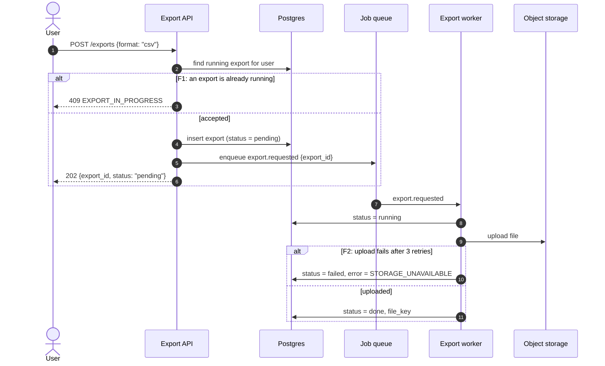
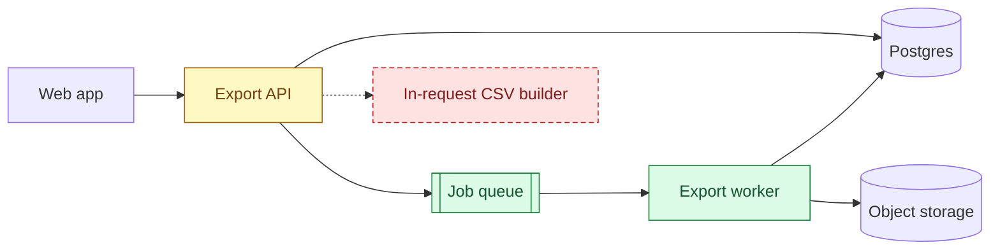
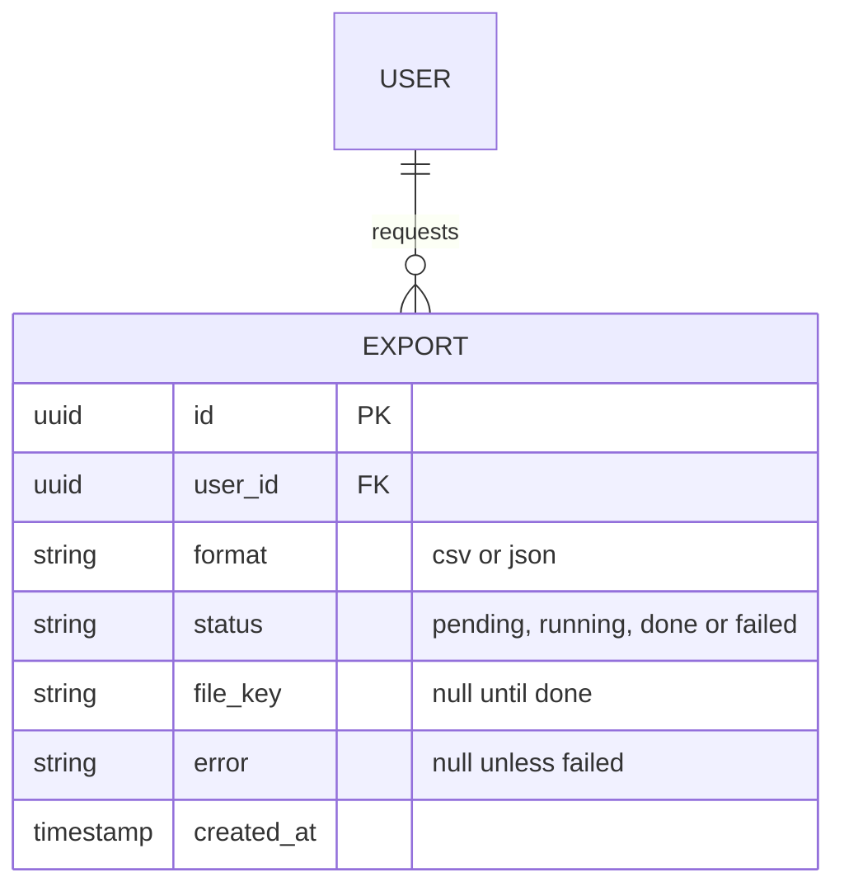
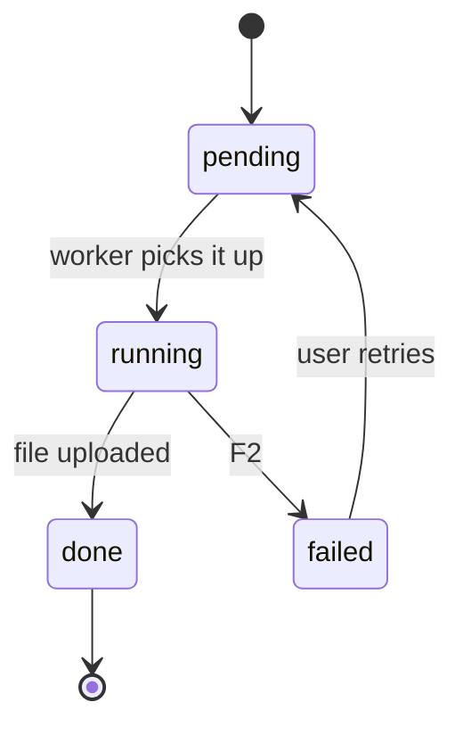

# <Feature name> — system design

- **Wireframe:** [wireframes/<screen>.html](../../wireframes/<screen>.html) (fullstack only; remove otherwise)
- **Spec:** `specs/<feature>/SPEC.md`, written after this design is approved
- **Design approved:** <YYYY-MM-DD> (chat)

The diagrams below are an example (a CSV export moved to a background job): replace them with the feature's real
names, fields and status codes. Keep only the sections this feature needs and delete the rest instead of leaving them
empty.

Mermaid pitfalls (each one fails to parse in Mermaid 11; run `design_preview.py --check` before the review):

- No `;` in sequence messages, notes or `alt`/`opt`/`break` labels: it ends the statement. Use a comma or "then".
- Quote flowchart node labels that contain `()`, `{}` or `[]`: `A["POST /exports (async)"]`, not `A[POST /exports (async)]`.
- Never name a flowchart node or a sequence participant `end` in lowercase (it closes a block). Use `End` or an alias.

## Summary

<Two or three sentences: what changes in the system and why.>

## Main flow

Label every failure branch `F1`, `F2`, …; each one gets a `### Scenario:` in the spec with the id in its title.



## Components

The system after the change. Colour what the change touches; unchanged parts keep the default style, removed parts
stay in the diagram with a dashed border.



## Data model



**Migration**

- **Backward compatible:** <yes / no, and who breaks if not>
- **Order:** <e.g. add table → deploy worker → switch API → remove old code path>
- **Backfill:** <none, or how and how long>
- **Rollback:** <what you run and what data is lost>

## Lifecycle



## Contracts

```http
POST /exports
Idempotency-Key: 6f1c2a9e-…
Content-Type: application/json

{"format": "csv"}
```

```http
HTTP/1.1 202 Accepted
Content-Type: application/json

{"export_id": "8c2e…", "status": "pending"}
```

| Status | Code | When | Client does |
|--------|------|------|-------------|
| 409 | `EXPORT_IN_PROGRESS` | an export for this user is pending or running (F1) | shows the running export |
| 422 | `UNSUPPORTED_FORMAT` | `format` is not `csv` or `json` | shows a validation error |

- **Idempotency:** <same key within 24 h returns the first response, …>
- **Versioning:** <additive change to v1 / new v2, deprecation window>
- **Events:** <name, payload, producer, consumers, delivery guarantee>

## Contract seam

Fullstack only: each wireframe state and the call that produces it.

| Wireframe state | Call | Response |
|-----------------|------|----------|
| "Preparing your export…" | `POST /exports`, then `GET /exports/{id}` every 2 s | 202, then `status: pending` / `running` |
| "Download" button | `GET /exports/{id}` | `status: done`, `download_url` |
| "An export is already running" banner | `POST /exports` | 409 `EXPORT_IN_PROGRESS` |
| "Export failed, try again" | `GET /exports/{id}` | `status: failed` |

## Open questions

- <Anything the reviewer should decide at this gate.>
